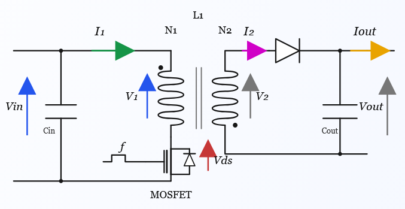

# Flyback Converter Calculator

A self-contained design tool for flyback power supplies. Enter the input voltage range, output voltage, load current, and switching frequency to get the operating point, proposed magnetizing inductance and turns ratio, and steady-state waveforms over one switching period.



## Features

- **Design inputs**: input minimum/maximum, a waveform-voltage slider bounded by that range, output voltage, output current, switching frequency.
- **Proposed values**: proposes the primary magnetizing inductance and N1/N2 turns ratio that place the converter at the continuous/discontinuous boundary at the average input voltage (50% duty). Uncheck the proposals to enter your own L and N1/N2.
- **Mode detection**: reports CCM or DCM, duty cycle, peak primary/secondary currents, current ripple, switch off-voltage, worst-case Vds at Vin max, and output power.
- **Waveform plots** (Canvas, no libraries):
  - Primary switch and secondary diode currents (independent vertical scales)
  - MOSFET drain-source voltage with Vin reference
  - Primary and secondary winding voltages
- **Input validation** with clear error messages; results update live as you edit.

## Quick start

1. Open `FlyBack.html` in any modern browser (double-click it; no server needed).
2. Enter your operating range — defaults shown are 22–32 V input, a 28 V waveform voltage selected with the range-bounded slider, 12 V output, 1 A, 200 kHz.
3. Keep *Propose primary inductance* and *Propose turns ratio* checked to auto-size L and N1/N2, or uncheck them and enter values manually.
4. Click **Calculate waveforms** (or just keep editing — results update automatically).

## Calculation model

With `Vf = 0.7 V` output diode drop and `Vout` the output voltage:

```
Vref = (Vout + Vf) · N1/N2
DCCM = Vref / (Vin + Vref)
ΔI   = Vin · D / (L · f)
Vds,off = Vin + Vref
```

Proposed values (at the CCM/DCM boundary, 50% duty, average input voltage):

```
N1/N2(proposal) = Vin,avg / (Vout + Vf)
L(proposal)     = Vin,avg² / [8 · (Vout + Vf) · Iout · f]
```

DCM operating point uses `peakPrimary = sqrt(2 · (Vout + Vf) · Iout / (L · f))`.

### Assumptions

- Ideal switch, no leakage inductance (no voltage spikes shown)
- Lossless magnetic coupling
- Diode drop fixed at 0.7 V
- Steady state; the estimated input power includes the output-diode drop, but real hardware has additional losses

## Files

FlyBack.html The calculator — all HTML, CSS, and JavaScript in one file, no external dependencies.
